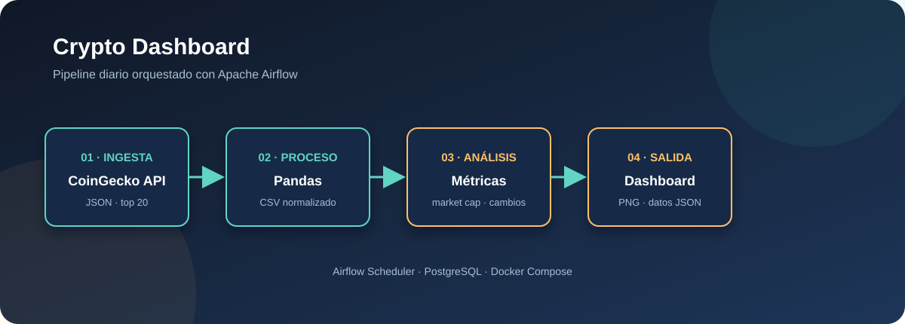

# Crypto Dashboard con Apache Airflow

Pipeline de datos para consultar las 20 principales criptomonedas desde CoinGecko, procesarlas con pandas y generar métricas y visualizaciones con Airflow.



## Flujo

1. `descargar_datos_coingecko`: guarda la respuesta de CoinGecko en JSON.
2. `procesar_datos_csv`: transforma los datos a CSV.
3. `analizar_estadisticas`: calcula métricas del mercado.
4. Genera gráficos de precios, market cap, precio vs. volumen y cambios de 24 horas.
5. Construye un dashboard consolidado.

El DAG se llama `crypto_dashboard_completo` y está configurado para ejecutarse diariamente.

## Requisitos

- Docker Desktop con Docker Compose
- Una cuenta o acceso a CoinGecko API

Crea un archivo `.env` en la raíz con estas variables:

```env
POSTGRES_USER=airflow
POSTGRES_PASSWORD=airflow
POSTGRES_DB=airflow
AIRFLOW_FERNET_KEY=replace-with-a-fernet-key
```

## Ejecución

```powershell
docker compose up -d --build
docker compose exec airflow-webserver airflow db migrate
docker compose exec airflow-webserver airflow users create --username admin --password admin --firstname Admin --lastname User --role Admin --email admin@example.com
```

Abre [http://localhost:8080](http://localhost:8080), inicia sesión y activa el DAG `crypto_dashboard_completo`.

## Resultados

Los archivos se guardan dentro de `dags/data/` y los gráficos dentro de `dags/charts/`. Entre ellos están `crypto_full.json`, `crypto_processed.csv`, `analysis_summary.json` y `00_dashboard_completo.png`.

## Estructura principal

```text
docker-compose.yaml   Servicios de Airflow y PostgreSQL
Dockerfile            Imagen con pandas y matplotlib
dags/cryptopipeline.py  DAG del pipeline
dags/data/             Datos procesados
dags/charts/           Gráficos generados
```
